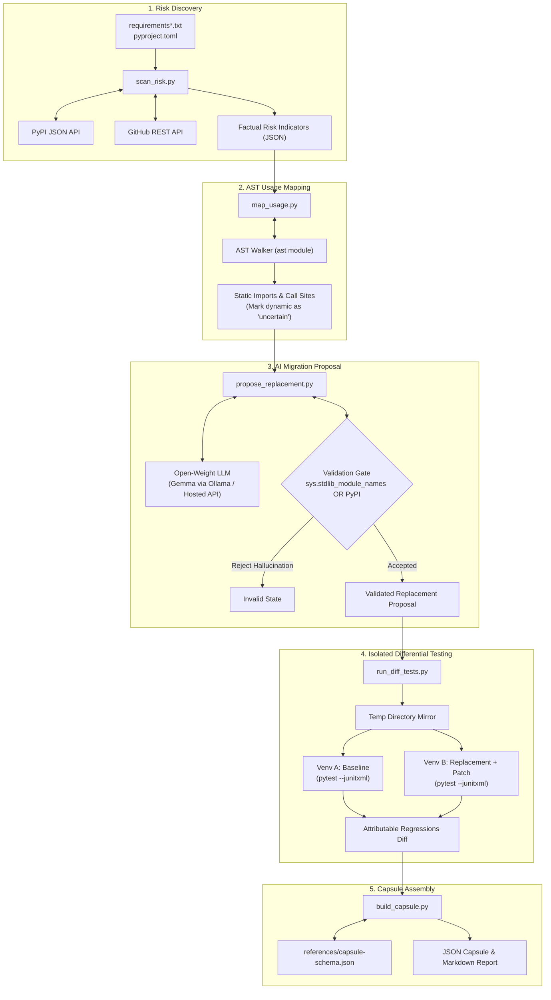

# 📦 Dependency Exit Capsule (`dependency-exit-capsule`)

[](https://agentskills.io)
[](https://www.python.org/downloads/)
[](https://opensource.org/licenses/MIT)

An Agent Skill adhering to the **`agentskills.io`** specification designed to find at-risk Python dependencies (abandoned, unmaintained, yanked, or superseded), map their AST usage across a codebase, query open-weight models (**Gemma**) for validated migration plans, differentials test original vs replacement in isolated environments, and produce an auditable **Dependency Exit Capsule**.

> [!NOTE]
> **Vulnerability Agnostic:** This skill completely ignores security CVEs and focus exclusively on architectural software maintenance risk, staleness, dead projects, and deprecation migrations.

---

## Architecture Diagram



---

## Installation & Setup

### Prerequisites
- Python 3.12+
- `uv` (recommended for instant venv creation) or standard `venv`
- Optional: `ollama` with `gemma2:2b` or hosted OpenAI-compatible API endpoint

### Setup
```bash
# Clone or navigate to the skill directory
cd dependency-exit-capsule

# (Optional) Run automated unit test suite
python -m pytest tests/test_capsule_suite.py
```

---

## Command Reference & Usage

The skill consists of 5 modular, stdlib-first CLI tools emitting JSON to `stdout` or `--output`:

### 1. `scan_risk.py`
Discovers declared dependencies and gathers empirical staleness, yanked status, archive status, and deprecation text.
```bash
python scripts/scan_risk.py --repo-path ../LinkWatch --dep toml --output assets/scan_toml.json
```

### 2. `map_usage.py`
Parses the AST of all Python files in the target repository to find every import, alias, and call site.
```bash
python scripts/map_usage.py --repo-path ../LinkWatch --dep toml --output assets/usage_toml.json
```

### 3. `propose_replacement.py`
Queries Gemma for replacement candidates with exact AST evidence, enforcing strict validation against `sys.stdlib_module_names` or PyPI.
```bash
# Local Ollama
python scripts/propose_replacement.py --dep toml --usage-file assets/usage_toml.json --provider ollama --ollama-model gemma2:2b --output assets/proposal_toml.json

# Hosted OpenAI-compatible endpoint
python scripts/propose_replacement.py --dep toml --usage-file assets/usage_toml.json --provider hosted --api-base https://api.groq.com/openai/v1 --api-key $API_KEY --hosted-model google/gemma-2-9b-it --output assets/proposal_toml.json
```

### 4. `run_diff_tests.py`
Executes differential testing in isolated virtual environments, attributing only new failures to the replacement.
```bash
python scripts/run_diff_tests.py --repo-path ../LinkWatch --dep toml --replacement tomllib --type stdlib --output assets/diff_tests_toml.json
```

### 5. `build_capsule.py`
Assembles all artifacts into an auditable capsule, validates schema compliance, and renders the Markdown report.
```bash
python scripts/build_capsule.py \
  --dep toml \
  --repo-path ../LinkWatch \
  --risk-file assets/scan_toml.json \
  --usage-file assets/usage_toml.json \
  --proposal-file assets/proposal_toml.json \
  --diff-test-file assets/diff_tests_toml.json \
  --schema references/capsule-schema.json \
  --output-json assets/capsule_toml.json \
  --output-md assets/capsule_toml.md
```

---

## Model Provenance & Licensing

| Attribute | Specification |
| :--- | :--- |
| **Model Family** | Google Gemma / Meta Llama 3.2 (Open-Weights) |
| **Tested Variants** | `gemma2:2b`, `google/gemma-2-9b-it`, `llama3.2:3b` |
| **Access Methods** | 1. Local daemon: `ollama` (`http://localhost:11434`)<br>2. Hosted OpenAI-compatible REST API (`api_base` + `api_key`)<br>3. Reference expert fallback |
| **Licenses** | [Gemma Terms of Use](https://ai.google.dev/gemma/terms) / [Llama 3.2 Community License](https://github.com/meta-llama/llama-models) |
| **Inference Constraints**| Strict JSON schema enforcement; rejects markdown formatting |

---

## Capsule Strict Rules

1. **Separation of Observed vs AI Claims:**
   - Top-level `observed` strictly contains verified tool outputs (AST coordinates, JUnit test metrics, PyPI upload timestamps).
   - Top-level `ai_generated` houses migration plans, suggested tests, and gap analyses.
   - Any bleeding of AI claims into `observed` causes immediate schema validation failure.
2. **Explicit Verification Status:**
   - Every finding carries a `status`: `verified`, `unverified`, or `not_testable`.
   - Never fake results: rate limits, missing tests, or unverified claims are explicitly flagged.

---

## Limitations

- **Binary Handle Compatibility:** In Python 3.11+, `tomllib.load()` requires binary handles (`open(path, 'rb')`), whereas legacy `toml.load()` accepted string filepaths.
- **Dynamic Imports:** Runtime dynamic imports via `eval()`, string interpolation, or complex custom loaders cannot be fully resolved statically and are marked as `uncertain`.
- **GitHub API Rate Limits:** Unauthenticated GitHub API calls are subject to IP rate limits (60 requests/hr). Use `--github-token` for uninterrupted repo metadata fetching.
